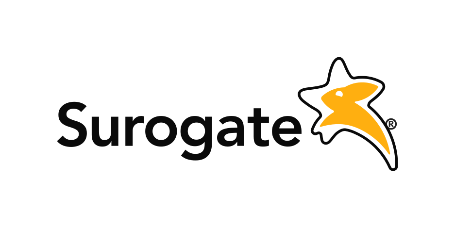
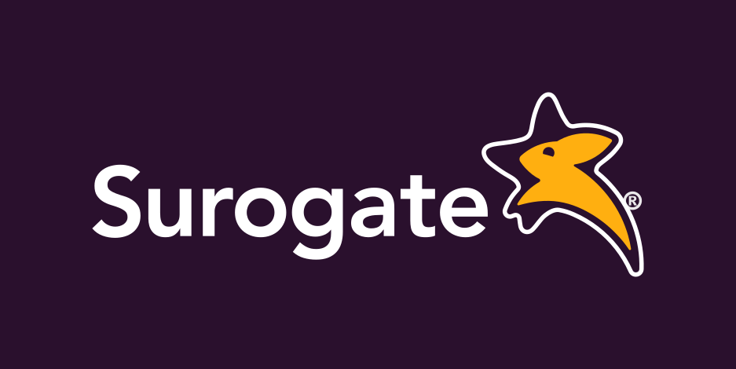
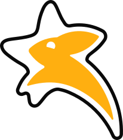
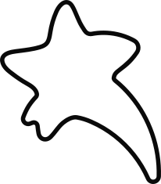
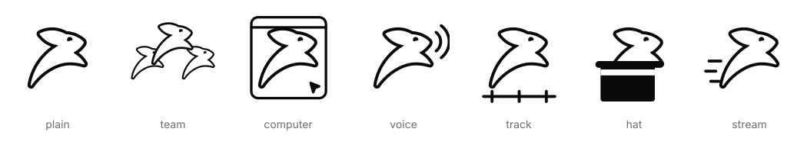
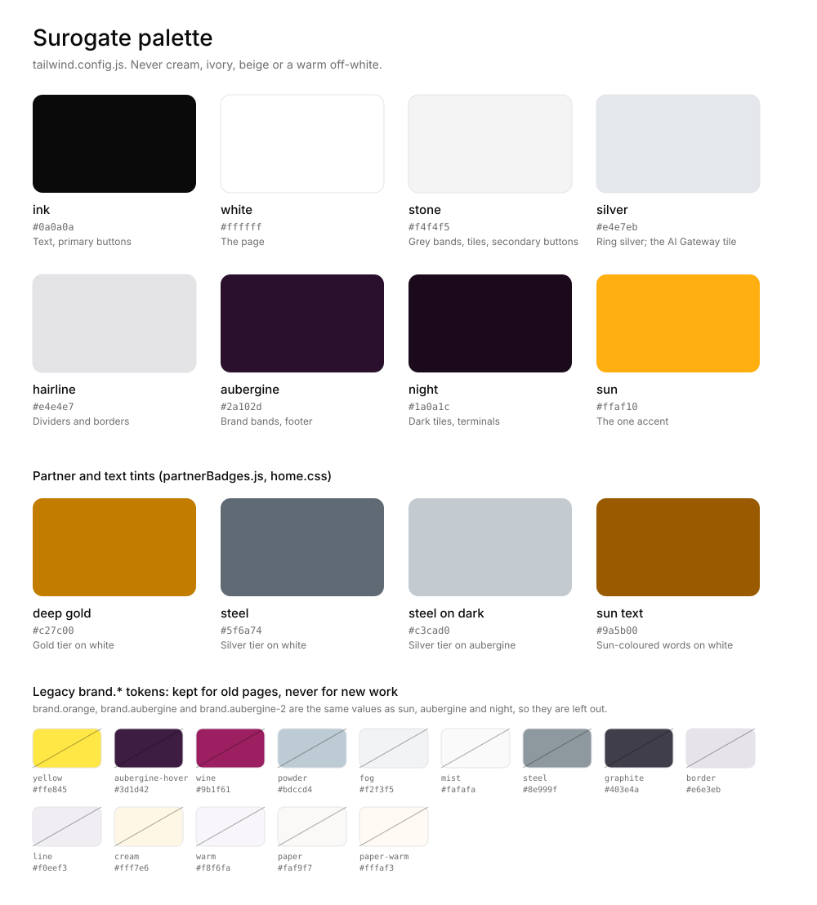
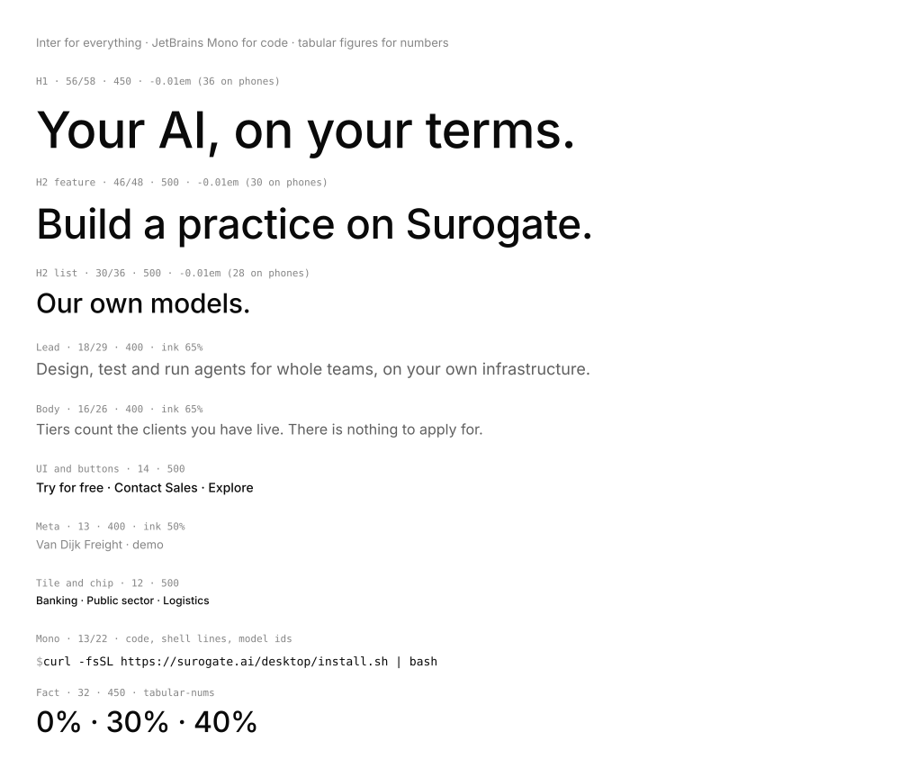
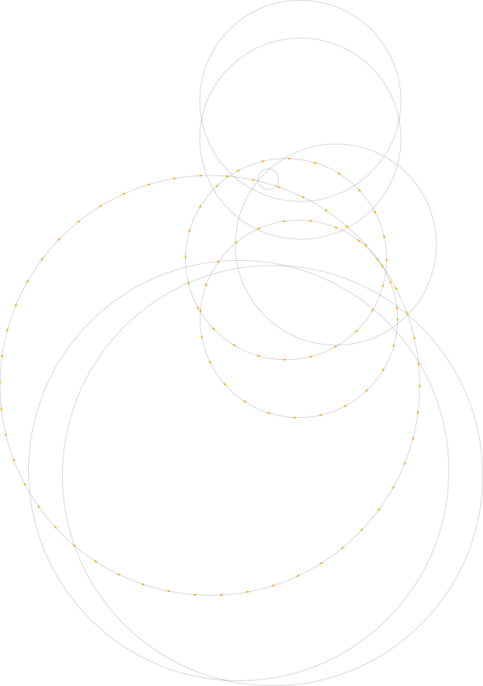
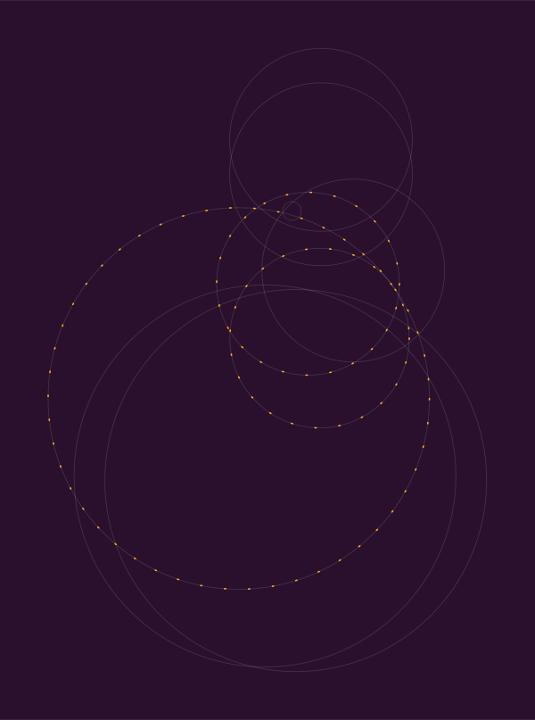
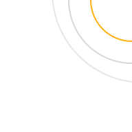

# Surogate brand identity

The reference for how Surogate looks, sounds and moves, extracted from the shipped site on `feat/site-v2`. Every
value below is in the code; the file path is given beside it. Every rule carries the reason it exists.

**Which file wins.** The owner's rules in `docs/superpowers/specs/2026-10-27-site-v2-learnings.md` outrank
everything, this file included. This file outranks §4 of `2026-10-27-site-v2-design.md`, which still lists
ivory, cream, a sun gradient code frame, a 1200px container and a cycling hero word: all of those were
rejected and are gone from the code. When the code and this file disagree, fix one of them the same day.

**Assets.** The marks in `assets/` are rendered from the site's own modules by `tools/export-marks.mjs`
(run `node docs/brand/tools/export-marks.mjs` from the repo root). Never edit an exported SVG by hand; change
the module and export again, so the site and this folder cannot drift.

## Contents

1. [Brand core](#1-brand-core)
2. [Logo](#2-logo)
3. [The rabbit system](#3-the-rabbit-system)
4. [Colour](#4-colour)
5. [Type](#5-type)
6. [Layout](#6-layout)
7. [Rings: Transit and Orbit](#7-rings-transit-and-orbit)
8. [Motion](#8-motion)
9. [No glows](#9-no-glows)
10. [Components](#10-components)
11. [Media](#11-media)
12. [Illustration and SVG](#12-illustration-and-svg)
13. [Accessibility](#13-accessibility)
14. [Banned list](#14-banned-list)
15. [Asset index](#15-asset-index)

---

## 1. Brand core

### What Surogate is

Surogate is a family of AI products from **Invergent S.A.**, built in Europe: agents for whole teams, a
desktop agent, voice agents, processes that run agents, an open-source training and serving engine, an open
inference market, and our own models. Everything runs on our cloud, in the customer's cloud, on their own
hardware or air-gapped.

- **Position line:** "Your AI, on your terms." (`app/layout.jsx` title, footer tagline.)
  Why: sovereignty is the headline, not a footnote. It is the one thing our buyers (banks, insurers,
  regulators, public sector) cannot get from a US-only vendor.
- **Footer line:** "Your AI, on your terms. Built in Europe by Invergent." (`components/Footer.jsx`)
- **Company line:** "Invergent S.A. makes Surogate, Surogate Desktop, Voice, Keel, the AI Gateway and our own
  models, on your hardware or ours." (`lib/site.js`, `/company/`)

### The product family

Source: `lib/products.js` (menu order, from the widest audience to builders). The nav's Products menu, the
home hero and bento, and the footer all read this one list.

| key | Name, as written | Route | Menu line | Rabbit pose | Bento tone |
|---|---|---|---|---|---|
| `agents` | **Surogate** | `/surogate/` | AI colleagues for every team, on your own infrastructure. | `team` | grey |
| `surogate` | **Surogate Desktop** | `/surogate-desktop/` | Your Surogate agent, working on the files on your computer. | `computer` | grey |
| `voice` | **Voice** (Surogate Voice in titles) | `/voice/` | Voice agents that listen and answer in real time. | `voice` | grey |
| `keel` | **Keel** | `/keel/` | Business processes that run agents, with approvals and audit. | `track` | grey |
| `train` | **Train** (Surogate Train in titles) | `/train/` | Train and serve your own model on one engine. | `hat` | night |
| `gateway` | **AI Gateway** | `/gateway/` | The open market for production inference, on one key. | `stream` | silver |

Naming rules, each with its reason:

- **The agents platform is "Surogate".** Never "Agents" as a product name, never "Surogate Agents".
  Why: owner's decision (2026-10-27); the platform carries the company name. `/agents/` redirects to
  `/surogate/` (`lib/site.js` REDIRECTS). A test enforces it (`components/products/products.test.mjs`).
- **The desktop agent is "Surogate Desktop"** at `/surogate-desktop/`, never `/desktop/`.
  Why: `/desktop/` serves the installer (`surogate.ai/desktop/install.sh`).
- **AI Gateway is llm.buzz.** "The open market for production inference." There is no `/api/` page; "Get API
  key" links to `https://llm.buzz`. Why: the old "API" product was renamed, and llm.buzz is the real product.
  - Two sides, always told together: **use any model at better prices** (providers compete) and **sell your
    inference** ("List your endpoint at your own price. We send you the callers.",
    `https://llm.buzz/providers/join`).
  - Facts we may state (source: llm.buzz pages fetched 2026-10-27): routing presets smart, cheapest, fastest,
    order; 0% markup; one key for every model; failover; EU-only routing on every plan; keys per project with
    spend limits; zero-retention routing.
- **llm.buzz** is written lowercase with the dot, even at the start of a sentence.

Our models and research (`lib/labs.js`, `/labs/`, labelled "Research" in menus):

| Name | What it is | Where |
|---|---|---|
| **Surogate 3.7 Flash** | Our open model, `surogate/surogate3.7-flash` on llm.buzz: 1M context, 32K output, $0.15/M input tokens (`FLASH.facts`) | announcement pill, home "Our own models", news |
| **Jackrabbit** | Speech recognition (Jackrabbit ASR, Jackrabbit Streaming ASR, 110M) | `/labs/speech/`, Voice |
| **Amami** | Text to speech (Amami TTS, 110M); the voice the site speaks with | `/labs/speech/`, Voice tile, home hero |
| **Rune** | A decision model that sees | `/labs/rune/` |
| **Surogate Engine** | The open-source C++/CUDA engine behind Train, Apache 2.0 | `/labs/engine/` |
| **Jackalope** | The desktop GUI for training, public releases on GitHub | Try menu |

Models do not appear in the Products menu. Why: Products sells what a team runs; models are the proof that we
train our own, so they live under Research and News.

### Information architecture

Source: `lib/site.js` (`MENUS`, `TRY_MENU`, `FOOTER`, `ROUTES`, `REDIRECTS`). Every internal link ends in `/`.

```
[logo]  Products▾  Solutions▾  Developer▾  Company▾  Pricing  News      (Contact Sales) (Try for free | ▾)
```

| Menu | Items |
|---|---|
| Products (mega) | the six products above, each a name and one line, with a live preview |
| Solutions | Customer Stories, Enterprise, Government, Banking & Insurance, Professionals, Custom Models, Security & Trust; "Explore all use cases" → `/solutions/` |
| Developer | AI Gateway, Documentation ↗, Console ↗, Open Source ↗, Status ↗ |
| Company | About, Research, Partners, Careers, Contact |
| Pricing, News | plain links |
| Try for free ▾ | Use it: Surogate ↗ (ops.surogate.ai), Surogate Desktop. Build: API key ↗, Train, Jackalope ↗. Business: Contact Sales, Become a partner |

Footer columns: Products, Solutions, Developers, Research, Company, Social, then "© 2026 INVERGENT S.A." and
"Status ↗". Why a Status link and no "All systems normal": we cannot back a claim we do not measure.

### Voice and tone

Plain, concrete, short. The mechanism before the benefit. Every number has a source in the repo
(`lib/labs.js`, `lib/products.js`, `lib/pricing.js`, llm.buzz snapshots with URL and date).

Measured limits (enforced by `lib/products.test.mjs`): a hero headline is at most 40 characters and ends with
a full stop; its sub-line at most 100 characters; a menu line at most 70 characters, with no speed claim in ms.

| Do (shipped copy) | Why it works |
|---|---|
| "Processes that run agents." | Says what Keel is in four words. |
| "Providers compete for every request." | Shows the mechanism of the market, not a benefit. |
| "Tiers count the clients you have live. There is nothing to apply for." | A rule the reader can check. |
| "Real product, filmed on demo businesses." | Says exactly what the footage is. |
| "Check each loan file and flag what is missing" (Banking brief) | A real job in a market we sell to. |
| "Start free with five agents and no card, or install the platform on your own Kubernetes." | Two concrete paths, no adjectives. |

| Don't | Why |
|---|---|
| "close out the card for month-end" | Rejected by the owner as a nonsense example. Use banking, public sector, logistics, professionals. |
| "early access" | The desktop app is released (`curl -fsSL https://surogate.ai/desktop/install.sh \| bash`). |
| "Agents" as a product name, "Surogate Agents" | The product is Surogate. |
| A voice's or a person's name in UI copy ("Doina") | Name the model and the language: "Hear Amami speak Romanian". |
| "under 200 ms" with no measurement | Every number needs a source in `lib/`. |
| `seamless`, `leverage`, `unlock`, `empower`, `powerful`, `cutting-edge`, `excited to` | Banned by `products.test.mjs` and `news.test.mjs`; they say nothing. |
| Em or en dashes, typed arrows, typed " · " separators in copy data | Banned by the same tests; separators are drawn by components, not typed. |
| Competitor or private repo names in copy | Banned by `lib/labs.test.mjs`. |
| "Get started" on every button | One primary action per section, and it names what it starts ("Start building", "Get API key", "Download Surogate Desktop"). |

---

## 2. Logo




### Ink and sun

Source: `components/site/Logo.jsx`, paths in `components/site/logo.js` (unchanged from
`public/brand/logo-full-white.svg`), viewBox `0 0 702.59 235.03` (about 2.99:1).

| Part | Colour | Why |
|---|---|---|
| Wordmark "Surogate" and the ® | `currentColor` (ink `#0a0a0a` on light, white on dark); ® at 90% | One component serves nav and footer. |
| Star (outlined) | `currentColor` | The star belongs to the wordmark's colour so the lockup reads as one piece. |
| Rabbit inside the star | sun `#ffaf10`, always | The rabbit is the one warm thing in the mark, the same sun as every accent. |

- **`small` prop:** below 40px tall the star gets a 3.2-unit stroke in its own colour. Why: the star's arms
  are thin and break up at nav size. Both shipped placements use it.
- **Draw-in (`draw` prop), nav only:** the star outline traces (1100ms), the star fills (500ms from 650ms),
  the sun rabbit rises 22px into place (900ms from 650ms), the wordmark fades in (700ms from 150ms). It plays
  **once per page load**: a module-level `drawn` flag stops client navigations from replaying it
  (`app/v2.css`, `.logo-draw`). Why: a mark that animates on every route change becomes noise; once, it is a
  greeting. Reduced motion shows the finished logo.

### Placement, clear space, minimum size

| Where | Size | Colour |
|---|---|---|
| Nav (`components/Nav.jsx`) | `h-7` (28px tall) in a 64px bar, 32px gap to the menu | ink, `draw small` |
| Footer (`components/Footer.jsx`) | `h-8` (32px tall), 16px above the tagline | white on aubergine, `small` |

- **Clear space: half the logo's height on every side.** Derived from the tightest shipped placement (the
  footer); the nav leaves more. No rule is written in code, so this is the floor, not a target.
  `assets/logo-on-light.svg` and `assets/logo-on-dark.svg` are drawn with exactly that margin.
- **Minimum size: 28px tall** for the full logo, the smallest size shipped and checked. Below it use the
  symbol, not a smaller logo.
- **Symbol:** the star and sun rabbit alone (`assets/star-rabbit.svg`) is the favicon (`public/favicon.png`,
  sun) and, mirrored, the Diamond partner mark.

### Don't

- Don't recolour the rabbit. It is sun on every ground. Why: the sun rabbit is what makes the mark ours.
- Don't put the logo on sun. The rabbit disappears.
- Don't use `public/brand/logo-full-gradient.svg`. It is the old gradient mark; no gradients in the mark.
- Don't add a glow, shadow, outline or plate. (See §9.)
- Don't retype the wordmark in a font, stretch it, or separate the star from the wordmark into a new lockup.
- Don't run the draw-in anywhere but the nav, and never twice in a session.

---

## 3. The rabbit system

  

### One silhouette, never redrawn

Source: `components/site/rabbit.js` (`RABBIT_FILL`, `RABBIT_OUTLINE`, `RABBIT_EYE`, box 71.04 × 72.72), taken
from `public/brand/rabbit.svg`. `components/site/Rabbit.jsx` draws every pose from those paths: the outline and
eye take `currentColor`, the body takes `--rabbit-bg` (default white).

Why: one silhouette keeps it one animal at every size and in every pose. The rule dates from the first spec
(§4.1): every pose starts from the official path, and only attributes are added around it.



| Pose | Product | Attribute |
|---|---|---|
| `plain` | the bare mark | none |
| `team` | Surogate | three rabbits, the middle one larger |
| `computer` | Surogate Desktop | a window frame with a cursor |
| `voice` | Voice | two sound arcs |
| `track` | Keel | a track with three stage ticks |
| `hat` | Train | a top hat ("pull your own model out of the hat") |
| `stream` | AI Gateway | three speed lines |

Other pieces: `RabbitAvatar` (the rabbit in a filled circle, the agent's avatar in chat panels, default
aubergine), `think` (a 0.9s hop), and `.rabbit-eye` (a blink every 5s). All still under reduced motion.

### Where the rabbit may appear

| Place | How | Source |
|---|---|---|
| The logo | the sun rabbit in the star | `Logo.jsx` |
| `/surogate/` | inline at 0.9em in the H1 ("Meet [team] Surogate."), the closing card's peek, chat avatars | `products/Page.jsx` `Hero`, `Closing`; `agents/Panels.jsx` |
| `/surogate-desktop/` | the same: H1 glyph and closing peek | `products/desktop/DesktopPage.jsx` |
| The Voice tile and mock | as **Amami**, breathing (scale 1.04 over 3.2s); pressing it plays Amami's greeting | `site/mocks/VoiceMock.jsx`, `home/Bento.jsx` |
| The Surogate 3.7 Flash cover | the simple rabbit is the model's own mark, sun on aubergine (owner's request) | `news/Cover.jsx` `Flash` |
| Partner marks | the tier is which rabbit you get | `site/illustrations/partnerBadges.js` |


### Where it must not

- **Not in menus.** The Products menu is a name and a line, no rabbit, no icon (`site.test.mjs`). Why: icons
  in menus were rejected; the preview beside the list carries the picture.
- **Not on other product pages, solution pages, the footer or general mocks.** `products.test.mjs` fails the
  build if the rabbit's eye path appears on any product page but Surogate and Surogate Desktop. Why: the
  rabbit is a character, like a mascot on its own product's page; pasted everywhere it becomes clip art.
- **Never in the team section.** People are shown as themselves: their photo, or their initials on
  aubergine (`components/company/parts.jsx`). Why: a mascot standing in for a person reads as a joke about them.
- **Not on bento tiles other than Voice.** Tiles carry media, the name and "Explore" only (commit `5840359`).
- **One rabbit pose per viewport**, menus apart (spec §4.1). Why: two characters on one screen compete.

### Partner tiers

Source: `components/site/illustrations/partnerBadges.js`, rendered by `components/site/PartnerMark.jsx`.
Every tier sits in the same 96-unit box, in one ring (r 46, stroke 1.5) in the tier's colour, the art
centred with its longer side at `54 × k` units, and **every rabbit faces right**. Why: the tier is read from
which rabbit you get, simple to complete, so everything else (size, ring, direction) is held constant.

| Tier | On aubergine (`tone="dark"`) | On white (`tone="light"`) | k |
|---|---|---|---|
|  **Silver** | the simple rabbit in steel `#c3cad0`, ring steel at 55% | steel `#5f6a74` | 1 |
|  **Gold** | the rabbit in sun `#ffaf10` plus one arm of the star as a sweep stroke along its back (2.6, round), sweep and ring in sun | rabbit sun with a 1.2 deep gold `#c27c00` edge, sweep and ring deep gold `#c27c00` | 1.04 |
|  **Diamond** | the logo's star and sun rabbit, mirrored to face right, star in white with a 6-unit stroke, ring white at 50% | star in ink | 1.24 |

Light versions:   

- Diamond's k of 1.24 makes the star fill its ring so its rabbit matches the others' size (commit `1a5a9b0`).
- Deep gold `#c27c00` exists because sun on white is 1.84:1 and vanishes; deep gold is 3.40:1, enough for a
  stroke and a ring.
- The marks read on aubergine and white at 40px (the comment in `partnerBadges.js`); shipped at
  `clamp(80px, 9vw, 120px)` on the home partners band and 112px on `/partners/`.
- Motion: once, on first view, the ring fades in (700ms), the rabbit settles from 4px below at 94% scale
  (900ms from 120ms), and on Diamond the sun rabbit rises 22px into the star (900ms from 520ms), as it does in
  the logo. Reduced motion never arms it, so the finished mark shows.
- Tiers mean: Silver, sign up, no fee. Gold, 1 client live. Diamond, 3 clients live, 40% share
  (`components/partners/Tiers.jsx`, `lib/pricing.js` `PARTNER_SHARE`).

---

## 4. Colour



### Tokens

Source: `tailwind.config.js` (`theme.extend.colors`). Use these names in classes; never type a hex in a
component when a token exists.

| Token | Hex | Role | Why |
|---|---|---|---|
| `ink` | `#0a0a0a` | text, primary buttons, the hero's market chip | near-black reads as decided; 19.8:1 on white |
| white | `#ffffff` | the page | owner: "pure white page" |
| `stone` | `#f4f4f5` | grey bands, tiles, secondary buttons, hovered menu rows | a neutral grey, cool not warm (see the hard rule) |
| `silver` | `#e4e7eb` | the silver of the rings; the AI Gateway tile | a cool grey with a hint of blue, from the brand circles |
| `hairline` | `#e4e4e7` | dividers, card and field borders | one line colour for the whole site |
| `aubergine` | `#2a102d` | brand bands (about every third section), the footer, the code panel | the brand's signature colour, used as a band, never a wall |
| `night` | `#1a0a1c` | dark tiles (Train), terminals, the film dialog | aubergine-black, so even code reads as ours |
| `sun` | `#ffaf10` | **the only accent**: arcs, the rabbit, the sun button, "New" tag, Gold tier | one accent spent once per view stays loud |

Supporting values found in code (not tokens; use only for the job named):

| Value | Where | Job |
|---|---|---|
| `#c27c00` deep gold | `partnerBadges.js` | Gold tier stroke and ring on white |
| `#5f6a74` / `#c3cad0` steel | `partnerBadges.js` | Silver tier on white / on aubergine |
| `#9a5b00` sun ink | `app/home.css` `--amber-ink` | sun-coloured words on white (5.43:1) |
| `#a85d00` | `components/site/Pill.jsx` | the announcement tag's text on `sun/15` (4.51:1) |

### Section and tile tones

| Where | Tone | Classes | Source |
|---|---|---|---|
| Section `light` | white page, ink text | `bg-white text-ink` | `components/site/Section.jsx` |
| Section `grey` | stone band | `bg-stone text-ink` | same |
| Section `aubergine` | brand band, white text | `bg-aubergine text-white` | same |
| Bento `grey` | Surogate, Desktop, Voice, Keel | `bg-stone !text-ink` | `components/home/Bento.jsx` |
| Bento `night` | Train | `bg-night !text-white` | same |
| Bento `silver` | AI Gateway | `bg-silver !text-ink` | same |
| Footer | aubergine | `bg-aubergine text-white` | `components/Footer.jsx` |

Rhythm: pages open white, take a stone band where a section needs separation, and an aubergine band roughly
every third section, closing on aubergine into the aubergine footer. Why: light first for clarity, aubergine
second so it reads as the signature, not a dark theme.

### Text opacity

Text is ink or white at fixed opacities, never a separate grey. Contrast measured against the ground
(WCAG 2 relative luminance):

| On light (ink on white) | Use | Contrast |
|---|---|---|
| 100% | headings, button labels, links | 19.80:1 |
| 75% / 70% | list text in cards, mobile menu links | 9.25:1 / 7.63:1 |
| 65% | hero and section sub-lines, body paragraphs (`SUB`, `SectionHead` `opacity-65`) | 6.31:1 |
| 60% / 55% | secondary lines, captions under titles, footnotes | 5.25:1 / 4.40:1 |
| 50% / 45% | meta lines ("Van Dijk Freight · demo", dates) | 3.71:1 / 3.16:1 |
| 40% | external-link arrows, Try-menu group labels, the shell `$` | 2.71:1 |

| On dark (white on aubergine) | Use | Contrast |
|---|---|---|
| 100% | headings, links on hover | 17.35:1 |
| 80% | footer links, emphasised lines | 11.33:1 |
| 70% / 75% | band body copy | 8.90:1 and up |
| 60% | footer column headings, the © line, the tagline | 6.84:1 |
| 55% / 50% | dates, step numbers | 5.94:1 / 5.12:1 |

Contrast notes:

- Anything a reader must read is 60% ink or stronger on light. 55% is just under AA (4.40:1); 50% and 45% fail
  AA for small text. They are used only for meta beside a stronger label, and that is a known gap, not a
  licence: do not set body copy below 60%.
- On aubergine every opacity the site uses passes AA (5.12:1 at 50%).
- Sun is an accent, never text on white (1.84:1). On aubergine sun text is 9.41:1 and fine (the partner tier
  conditions in `Tiers.jsx`). Aubergine on sun is 9.41:1 (the sun button).
- Hairline on white is 1.27:1 by design: a divider, not a boundary someone has to find.

### Hard rule: never cream

**Never cream, ivory, beige, paper or any warm off-white**, for a ground, a tile, a card, footage or text on
dark. Text on dark surfaces is pure white.

Why: the owner rejected it outright (2026-10-28). Warm off-white reads as yellow and dated on most screens, and
it made the site look like a template. Commit `41974c3` replaced cream and ivory with white, neutral grey and
ring silver everywhere. The rule reaches footage too: the Clarke film has no 2160 cut because its phone
capture has a cream chat wallpaper and waits for a re-shoot (`lib/films.js`).

The legacy `brand.*` palette in `tailwind.config.js` (cream `#fff7e6`, warm `#f8f6fa`, paper `#faf9f7`,
paper-warm `#fffaf3`, wine `#9b1f61`, yellow `#ffe845` and the rest) and the gradients and glow shadows beside
it serve pages not yet moved to v2. **Never use them in new work.** `brand.orange`, `brand.aubergine` and
`brand.aubergine-2` equal `sun`, `aubergine` and `night`; use the short names.

---

## 5. Type



### Faces

Source: `app/layout.jsx` (next/font), `tailwind.config.js` (`fontFamily`).

| Face | Variable | Use | Why |
|---|---|---|---|
| **Inter** | `--font-inter`, `font-sans` | everything: display, body, UI | one family keeps a dense product site calm; weights carry the hierarchy |
| **JetBrains Mono** | `--font-mono`, `font-mono` | code, shell lines, model ids, hosts | code must look like code; nothing else is set in mono |
| Fraunces | `--font-fraunces`, `font-serif` | **legacy only**: old pages' `h1` to `h4` default | v2 opts out with `.v2 :is(h1,h2,h3,h4) { font-family: inherit }` (`app/globals.css`) |

### Scale

| Role | Size (phone → desktop) | Weight | Leading | Tracking | Source |
|---|---|---|---|---|---|
| H1, product and inner pages | 36 → 56 (`md`) | 450 | 1.08 → 1.04 | -0.01em | `products/Page.jsx` `H1` |
| H1, home hero | 36 → 48 (`md`) → 56 (`lg`) | 450 | 1.1 → 1.05 | -0.01em | `home/Hero.jsx` |
| H2 `feature` (big split sections, bands, closings) | 30 → 46 | 500 | 1.1 → 1.05 | -0.01em | `Section.jsx` `H2.feature` |
| H2 `list` (heads a grid) | 28 → 30 | 500 | 1.15 → 36px | -0.01em | `Section.jsx` `H2.list` |
| Stat number | 44 → 56 | 400 | 1 | -0.02em | `StatStrip.jsx` |
| Fact number | 28 → 32 | 450 | 1 | -0.01em, tabular | `Page.jsx` `Facts` |
| H3, scroller step | 22 → 24 | 500 | 1.25 | | `Scroller.jsx` |
| H3, card | 18 | 500 | | | `GetStarted.jsx`, `Tiers.jsx` |
| Lead / sub-line | 16 → 18 | 400 | 1.6 | | `Page.jsx` `SUB` |
| Body | 16 | 400 | 1.6 | | `SectionHead`, bands |
| Card body | 15 | 400 | 1.6 | | `Tiers.jsx`, `GetStarted.jsx` |
| UI, buttons, nav | 14 | 500 | | | `Button.jsx`, `Nav.jsx` |
| Meta, captions, tabs | 13 | 400 to 500 | | | `CodeTabs`, captions |
| Chip, tile label | 12 | 500 | 16px | | hero market chip |
| Group label (only uppercase use) | 11 | 500 | | 0.08em, uppercase | Try menu |

Rules, each with its reason:

- **H1 at most 56px desktop, 36 phone; H2 30 to 48; body 16 to 18.** Why: "type is smaller and calmer than you
  think" (owner). One H1 size across product, solutions, pricing and news pages (commit `bce5368`).
- **Inside cards and tiles, 12 to 15px.** Nothing at hero scale inside a tile. Why: hero-size type in tiles was
  sent back.
- **Weights: 400 body, 450 display, 500 headings and UI.** 600 appears twice (the announcement title and the
  home dev facts) and is not a step to add. Why: Inter at 450 is a touch lighter than the 500 used for H2s
  and reads calmer at 56px; the first spec set display at 450 to 500.
- **Tracking -0.01em on display, -0.02em on stat numbers, 0 on body.**
- **Sentence case everywhere**, headlines end with a full stop ("Our own models."). Uppercase only for the
  11px Try-menu group labels.
- **Tabular figures** (`tabular-nums`) wherever numbers line up or change: facts, step numbers ("01"),
  release dates, prices in the gateway cover. Why: proportional digits jitter in columns.
- **`text-balance`** on H1 and sub-lines, `text-pretty` on section subs on phones. Why: no single-word last
  lines in headlines.
- Mono at 13px with 1.7 leading for code (`CodeTabs`), 12 to 13px in shell lines and inline ids.

---

## 6. Layout

### Container and rhythm

| Thing | Value | Source | Why |
|---|---|---|---|
| Container | `mx-auto max-w-[1280px] px-4 md:px-6`: 1280 wide, 16px gutters on phones, 24 from `md` | `Section.jsx` `CONTAINER` | owner's numbers; the 1200 in the old spec is superseded |
| Section padding | `py-16 md:py-24`: 64 phone, 96 desktop | `Section.jsx` | one rhythm for every page |
| Section divider | 1px `hairline`, `w-[calc(100%-32px)] max-w-[1328px]`, centred | `Section.jsx` | a little wider than the content, never edge to edge |
| Nav | sticky, 64px | `Nav.jsx` | anchors use `scroll-mt-16` to clear it |

- **Dividers are contained, never full bleed.** Why: owner's rule; a full-bleed line cuts the page into
  strips. The scanner in the design repo now flags full-bleed section borders.
- **A light section after a coloured one drops its hairline** (`app/v2.css`,
  `[data-tone]:not([data-tone="light"]) + section > .section-rule`). Why: colour already separates them.
- **`divider="orbit"`** swaps the hairline for the Orbit divider once per page, to mark a turn (home: into
  "Our own models").

### Grid

| Pattern | Columns | Source |
|---|---|---|
| Home bento | 24 columns at `lg`, tiles span 13/11 and alternate sides per row; 2 columns at `md`; 12px gap; 220 / 280 / 300px tall | `home/Bento.jsx` |
| Split feature (text + visual) | `lg:grid-cols-[5fr_7fr]`, 40px gap, 64 at `lg` | `DevApi.jsx`, `Scroller.jsx` |
| Partners band | `lg:grid-cols-[1.2fr_1fr]` | `PartnersBand.jsx` |
| Cards and films | 1 → `sm` 2 → `lg` 3 or 4, gap-x 12, gap-y 32 | `Films.jsx`, `Research.jsx` |
| Footer | 2 → `md` 3 → `lg` `1.4fr repeat(6,1fr)` | `Footer.jsx` |

Why the bento alternates: tiles of exactly equal size were sent back; size follows what each holds.

### Radii and elevation

| Thing | Radius |
|---|---|
| Tiles, bands' inner panels, closing card, dialogs | 16 (`rounded-2xl`) |
| Cards, code card, video cards, hero action box | 12 (`rounded-xl`) |
| Video window (`VideoFrame`) | 10 |
| Menu rows, small panels | 8 (`rounded-lg`) |
| Market chip | 6 (`rounded-md`) |
| Buttons, pills, segmented controls, copy line | full |

Elevation is hairline before shadow. The few shadows are long and soft and never coloured light:

| Element | Shadow |
|---|---|
| Menu panels | `0 16px 48px -8px rgba(0,0,0,.22)` plus a 6% ink border |
| Code card on aubergine | `0 24px 60px -28px rgba(26,10,28,.55)` |
| Video window | `0 1px 2px rgba(0,0,0,.06), 0 8px 24px -12px rgba(0,0,0,.25)` plus an 8% ink ring |
| Segmented thumb | `0 1px 2px rgba(0,0,0,.08), 0 0 0 1px rgba(0,0,0,.04)` |

Cards and tiles hover by drifting their media (scale 1.02) and nudging the arrow 2px. No lifts, no shadows on
hover (`app/v2.css`). Why: lifting cards is a template tell; the content moving is enough.

### Breakpoints

Tailwind defaults: `sm` 640, `md` 768, `lg` 1024, `xl` 1280, plus `min-[380px]` for the Segmented padding.
`lg` is where the nav becomes a bar, the scroller pins, rings appear in closing bands and the bento goes to
24 columns.

### Phone first

Checked at 360, 390 and 1440 wide.

- **Tap targets 40 to 44px.** Controls that are 32 to 36px on desktop grow to 40 on phones (`h-10 sm:h-8` in
  `CodeTabs`, `h-10 md:h-9` in `Segmented`, `h-10 sm:h-9` in `CopyLine`, `h-10 md:h-6` on the hero progress
  segments). The burger, the play button, `lg` buttons and text links are 44 (`h-11`, `min-h-11`). Footer links
  get full-height rows (`py-2.5`). Why: a pass of phone fixes (`cf68152`, `91b5ce5`, `dc697f3` and others)
  found controls a thumb could not hit reliably.
- **Button pairs stack full width when they wrap** (`max-sm:w-full`, commit `89eca4a`). Why: two half pills
  wrapping unevenly look broken.
- **Rows of cards scroll sideways with the next one peeking**: `snap-x snap-mandatory`, cards `w-[84%]` on
  phones and `sm:w-[46%]`, grid again at `lg` (`pricing/PricingTabs.jsx`). Why: tablets squeezed four plan cards into four columns
  (commit `b742c56`).
- **Scrollable code fades at the right edge** while a line runs on (`CodeTabs` mask, last 40px), and shell
  lines scroll inside their pill without a scrollbar (`CopyLine`). Why: a phone reader has to know it scrolls;
  the box never grows.
- **The scroller does not pin on phones**: each step carries its own panel inline.
- **Footage may run edge to edge on phones** (`-mx-4 w-[calc(100%+2rem)]`, Voice) so a 16:10 UI recording
  stays legible.

---

## 7. Rings: Transit and Orbit

 

### Transit

Source: `components/site/Rings.jsx` (default export `Transit`), styles in `app/v2.css` (`.transit`).

The nine brand rings of `public/surogate_circles.svg`, as `[cx, cy, r]` in a `0 0 1825 2592` box. They meet at
the last, small ring: the rabbit's eye. The rings **hold still** as 1px hairlines (`vector-effect:
non-scaling-stroke`) in the text colour at 16% on light and white at 14% on dark (the silver of the circles).
Three short **sun arcs** (2px, round caps, `stroke-dasharray: 5 95` on `pathLength="100"`) travel three of the
rings at 64s, 46s (reversed) and 88s per turn, offset 13s apart.

Why still rings with travelling arcs: spinning rings read as a loader; still rings with one small moving light
read as a system at work, and the motion is slow enough to ignore.

**Allowed in two places only:**

1. **A quiet hero background.** Home: beside the headline, masked so it fades toward the centred copy and out
   before the first bento row, hidden on phones (`.hero-rings` in `Hero.jsx`). Product heroes: each product's
   own composition (below), shown only outside the content column.
2. **Aubergine closing bands.** `<Section tone="aubergine" rings>`: the rings sit right, `bottom-[6%]
   -right-[3%]`, about 26% of the band's width (32% at `xl`), rising from inside the band and ending above its
   lower edge, so only the top edge crops them. Hidden below `lg`. The copy and actions stack on the left.
   Why: nothing may be cut where the band meets the footer (commit `820a463`), and below `lg` there is no room
   beside the copy.

**Banned:**

- Inside cards, tiles, panels, covers or media boxes. Boxes stay clean (owner, 2026-10-28; commits `5840359`,
  `1ce6fca`, `b945017`).
- Under text, controls or media. Product hero rings are masked to show only beyond the content column
  (`.rf-col`, an 880px column with 24 to 64px of fade); band rings only beyond the 1232px content edge
  (`.rf-band`). Commit `af3c122`.
- On phones in closing bands.

### Product ring compositions

Source: `components/products/RingField.jsx` (Transit's terms with custom geometry), placement in
`components/products/rings.js` (`HERO_RINGS`, `HERO_RINGS_UNDER`, `BAND_CLIP`, `BAND_RINGS`, the `at()`
helper), styles in `components/products/products.css`.

| Product | Composition | File |
|---|---|---|
| Surogate | one agent, nine channels: a ring for the agent with a small ring for each channel standing on it | `products/agents/Rings.jsx` |
| Surogate Desktop | cloud, computer and sandbox rings | `products/desktop/Rings.jsx` |
| Voice | sun ripples leave the call and fade as they widen | `products/voice/Rings.jsx` |
| AI Gateway | provider rings meet at the request; the router's mark leaves along one provider's ring per request | `products/gateway/Rings.jsx` |
| Train | converging rings | `products/train/Rings.jsx` |
| Solutions | hero rings | `components/solutions/HeroRings.jsx` |

Each draws the product's own idea in rings; none is decoration you could move to another product.

### Orbit

Source: `components/site/Orbit.jsx`. Two overlapping hairline rings cut from the same constellation. **Only one
ring in any glyph is sun**; the other takes the text colour, so each piece works on light and dark.

| Piece | Look | Props | Used |
|---|---|---|---|
|  `OrbitMarker` | two 6-radius rings, one ink, one sun | `size=22`, `className` | in the set, not yet placed |
|  `OrbitBullet` | one 3-radius sun ring, 1.3 stroke | `size=10` | list bullets in `GetStarted` (replaced checkmarks) |
|  `OrbitDivider` | two hairlines either side of a ring pair (ink at 35%, sun) | `className` | `Section divider="orbit"` |
|  `OrbitProgress` | a ring at 14% with a 22% sun arc turning in 1200ms | `size=18`, `label='Loading'` | in the set; has `role="img"` and a label |
|  `OrbitCorner` | three arcs out of a card's top-right corner, one sun | `size=96`; card needs `relative overflow-hidden` | in the set, not yet placed |

`OrbitCorner` sits in a card's corner, which is a ring inside a box. Before placing it, check it against the
"no rings inside boxes" rule with the owner; it predates that rule.

---

## 8. Motion

Source: `app/v2.css`, `components/products/products.css`.

| Token | Value | Use |
|---|---|---|
| `--ease-out` | `cubic-bezier(.16,1,.3,1)` | every entrance, crossfade, slide and the segmented thumb |
| `--ease-ui` | `cubic-bezier(.4,0,.2,1)` | hovers, 150ms |
| Menu open / close | 180ms `--ease-out` / 120ms `--ease-ui`, scale .96 → 1 | `.menu-pop` |
| First-paint rise | `rise` from `translateY(var(--y, 12px))`, 250 to 650ms | `.load-up`, `.hero-w` |
| Media drift on hover | 500ms `cubic-bezier(0,0,.2,1)`, scale 1.02 | `.tile-media` |

Rules, each with its reason:

- **One ease.** Why: a different curve per component was sent back; one curve makes the site feel like one
  hand.
- **Transform and opacity only.** Progress and fills are CSS keyframes on `transform: scaleX`, one continuous
  run, never stepped by JS ticks. Why: progress segments filled by JS ticks were sent back in review; a keyframe
  runs on the compositor and cannot drift from the slide it times (commit `0927041`).
- **No layout shift, ever.** Anything that changes has a fixed footprint; alternatives are stacked in one grid
  cell and crossfade. The hero reserves the tallest headline (every variant sits invisible in the same cell)
  and a fixed action box (112px phone, 76px desktop); the mega-menu's six previews stay mounted and crossfade
  in a fixed 760 × 480 panel; the scroller's panels stack in one 16:11 box. Why: content that moves when
  something switches was sent back.
- **Loops run only while on screen.** `useLive(ref)` (`components/site/Rings.jsx`) sets `data-live` while the
  element is at least 15% visible, and the CSS runs the animation only then. `LoopVideo` plays at 25%
  visibility and pauses off screen. Why: nothing burns battery where nobody is looking.
- **Reduced motion shows the final state.** Every animated element rests on its final frame, so stopping the
  animation leaves the finished picture: the logo drawn, partner marks set, arcs at rest, videos as posters,
  the hero brief fully typed, the slide swapping without letters moving.
- **Nothing pauses on hover.** Why: rotation paused on hover was sent back; it made the page feel stuck under
  a resting mouse.

### The home hero rotation

Source: `components/home/Hero.jsx`, `components/home/HeroAction.jsx`.

- The headline, its sub-line and the actions change **together**, per product, in menu order. The bento tile
  of the current product gets a 1px ring. Why: a single cycling word and a "where should it run" switch were
  both rejected.
- Letters leave in reverse (320ms, 8ms stagger) and enter in order (400ms, 18ms stagger), inside unbreakable
  word boxes so wrapping matches the plain text. Screen readers get the plain headline in a polite live region.
- **Six separate progress segments**, each 24 × 2px, 6px apart, with a 40px tap area on phones. Done ones
  are full and still, upcoming ones empty, only the current one fills (`.seg-run`, linear, one run). Its
  `animationend` advances the slide. On a wrap the full ones fade out together (300ms) before the first runs.
  Why: an active segment wider than the rest was sent back; every segment is one width and the fill marks it.
- **Dwell:** Surogate's slide lasts `1000 + words × 140 + 3000` ms, so the brief finishes typing and holds 3s
  before the slide advances. Every other slide lasts 7000ms. Why: a slide must never change mid-sentence.
- **Pauses** only while an Amami sample plays, while a control has keyboard focus (so a focused button never
  changes under the key press), and while the tab is hidden. Never on hover.
- Each pass shows the next brief and the next Romanian line (Banking, Public sector, Logistics).

---

## 9. No glows

**No glowing or pulsing dots, no blurred halos, no radial light blobs, no SVG blur filters, no glowing pills,
no status dots.** Owner, 2026-10-28.

The incident: a pulsing `keel-glow` on the Keel tile, a flashing `bf-glow` on the Keel board drawing and a
blurred glow in the partners share drawing shipped in the first build. They read as generated "AI" decoration
and were removed (`fab2f6c`, `f70caf9`), and the rule was written the same day (`4feb5e7`).

- **The one exception: the frosted sticky nav** (`bg-white/85 backdrop-blur-md`). It is a material, not a
  light, and it keeps the page legible under the bar.
- The `CodeTabs` tab rail on the aubergine panel also uses `backdrop-blur-sm` over a flat colour, where it has
  no visible effect. Treat it as a leftover, not a second exception.
- Masks are not glows: the hero-ring fade, the product-ring column clip and the code edge fade use gradient
  *masks* that hide hairlines; nothing gradient is drawn. Each carries a `deslop-ignore` with that reason.
- The bento name row sits on a short fade of the tile's own colour (`bg-gradient-to-t from-stone`) so the name
  reads over media. It is a legibility scrim in the tile's colour, never a coloured light.
- The legacy `glow`, `sun-glow`, `evening-glow` and `grad-*` entries in `tailwind.config.js` are banned in new
  work.

---

## 10. Components

Every shared component, with its props, a usage copied from the site, and its rules. Paths are from the repo
root.

### Button

`components/site/Button.jsx`. A pill link. Props: `href`, `variant` (`primary`), `size` (`md`), `arrow`,
`event`, `eventProps`, `external`, `className`.

| Variant | Look | Use |
|---|---|---|
| `primary` | `bg-ink` white text, hover `brightness-90` | the one primary action on light |
| `secondary` | `bg-stone` ink text, hover `bg-hairline` | the second action beside a primary |
| `sun` | `bg-sun` aubergine text | the primary on an aubergine band |
| `glass` | `bg-white/10` white text, hover `white/15` | the secondary on an aubergine band |

| Size | Height | Padding | Text |
|---|---|---|---|
| `md` | 40px | 18px | 14px medium |
| `lg` | 44px | 20px | 14px medium |

`arrow` adds a chevron whose stem fades in on hover (› at rest, → on intent) and nudges 2px. `event` routes
through `TrackedLink` (every CTA carries a PostHog event); `external` opens a new tab.

```jsx
<Button href="/partners/" variant="sun" size="lg" arrow>Become a partner</Button>
```

- Do: one primary per section; `sun` + `glass` on aubergine, `primary` + `secondary` on light.
- Don't: two primaries side by side; a sun button on white (sun is an accent, not a ground for text on light).

### Section, SectionHead, H2, CONTAINER

`components/site/Section.jsx`.

- `Section` props: `tone` (`light` | `grey` | `aubergine`), `divider` (default on for light; `"orbit"` for
  the Orbit divider; `false` off), `rings` (closing-band Transit), `id` (adds `scroll-mt-16`), `className`,
  `inner` (classes for the inner container).
- `SectionHead` props: `title`, `sub`, `align` (`left` | `center`), `action` (a link at the right).
- `H2.feature`, `H2.list`: the two H2 class strings. `CONTAINER`: the container class string.

```jsx
<Section tone="aubergine" rings inner="flex flex-col items-start gap-6">
  <div>
    <h2 className={H2.feature}>Rather chat?</h2>
    <p className="m-0 mt-4 max-w-[46ch] text-[16px] leading-[1.6] text-white/70">Ask about agents, models or the engine on our Discord.</p>
  </div>
  <Button href={CONTACT.discord} variant="sun" size="lg" external arrow event="reach_out_clicked" eventProps={{ channel: 'discord', location: 'contact' }}>Join our Discord</Button>
</Section>
```

- Do: `rings` only on an aubergine closing band whose copy stacks left.
- Don't: `rings` on a light or grey section, or on a band with content on the right.

### Product page parts

`components/products/Page.jsx`: `Page` (nav, main, footer, `v2` class), `Hero` (`name`, `title`, `pose`,
`rest`, `sub`, `actions`, `note`, `rings`, `children`), `Lead` (`title`, `sub`, `center`, `size`), `Facts`
(`items` of `{n, l}`, `dark`), `UseCases` (`items` of `{market, job, line, href}`), `Closing` (`title`, `line`,
`action`, `peek`), and the `H1` and `SUB` class strings.

```jsx
<Closing title="Meet your first agent." peek="team"
  line="Start free with five agents and no card, or install the platform on your own Kubernetes."
  action={<Button href={SIGN_IN} size="lg" arrow event="cta_signup_clicked" eventProps={{ location: 'agents_closing' }}>Start building</Button>} />
```

- `pose` and `peek` are for the two character pages only (§3).
- `Facts` numbers come from `lib/`, each with its condition in the label.

### Nav

`components/Nav.jsx`. White, sticky, 64px, `border-b hairline`, frosted.

- **Menus** open on hover or click; a keyboard press toggles; Escape closes and returns focus to the trigger;
  a pointer down outside closes. Panels pop from 96% scale (`.menu-pop`).
- **Products mega menu:** 760 × 480, a 272px list (name 14px medium, line 13px at 55%) and a preview that
  crossfades in 170ms. All six previews stay mounted in one box (no remount flash, no resize) and the panel is
  built on first open. Each preview sits on its bento tone. No icons. Surogate shows its footage padded in a
  `VideoFrame` (`isFootage`); the inactive one shows its poster only (`still`). Surogate Desktop's preview is
  `SurogateMock`, a 12-message chat (filing scanned invoices) that fills the panel and drifts upward on a 22s
  loop, user bubbles in ink, agent bubbles in silver, edges faded by `.fade-y`. The other four show their mocks.
- **Plain menus:** 260px, rows 14px with ↗ on external links; Solutions ends in a stone "Explore all use
  cases" row.
- **Try for free split pill:** the main part (`rounded-l-full`, ink) goes to `ops.surogate.ai`; the chevron
  part (`rounded-r-full`, 20% white divider) opens a 240px menu in three groups, Use it, Build, Business,
  with 11px uppercase group labels. Beside it, `Contact Sales` as a secondary button.
- **Mobile (below `lg`):** a 44px burger opens a full-height sheet under the bar: plain links and `details`
  accordions in 17px rows with hairlines, then Contact Sales and the split pill stacked, with the Try options
  in two columns. Focus is trapped in the sheet and the burger; body scroll locks; a tap on any link closes
  it; widening to `lg` closes it.

Don't: add icons, badges or a rabbit to menu entries; change the preview box size per product.

### Footer

`components/Footer.jsx`. Aubergine. A 10% white hairline at the top keeps an aubergine closing band and the
footer two things. The white logo (32px), the tagline (14px, 60%), six link columns (headings 13px at 60%,
links 14px at 80%, white on hover, full-height tap rows on phones), then a bottom row with
"© 2026 INVERGENT S.A." and "Status ↗".

### Segmented

`components/pricing/Segmented.jsx`. A stone pill with a white thumb that slides under the chosen option,
measured so labels keep natural widths (300ms `--ease-out`). Props: `options` (`{id, label}`), `value`,
`onChange`, `label` (aria), `size` (`md` | `sm`), `role` (`tablist` | `radiogroup`), `controls` (id of the
panel each tab controls).

```jsx
<Segmented options={BILLING} value={billing} onChange={setBilling} label="Billing period" size="sm" role="radiogroup" />
<Segmented options={PRICING_TABS} value={tab} onChange={choose} label="Plans for" controls={(id) => id} />
```

- `tablist` when it switches panels; `radiogroup` when it sets a value. Arrow keys move the choice with roving
  `tabIndex`, as in a native radio group.
- Labs pages have their own `components/labs/Segmented.jsx` with an `onPick` API; prefer the pricing one for
  new work.

### CodeTabs

`components/site/CodeTabs.jsx`. A white code card with a hairline and a Copy button, its language tabs
underneath as soft pills on the aubergine panel. Props: `tabs` (`{label, code}`).

```jsx
<div className="min-w-0 rounded-2xl bg-aubergine px-4 pt-8 pb-5 md:px-10 md:pt-10 md:pb-6">
  <CodeTabs tabs={TABS} />
</div>
```

- The `pre` is as tall as the longest snippet plus a scrollbar, so switching tabs never moves the page.
- Mono 13/1.7; the right edge fades while a line runs past it; tabs are 40px on phones, 32 from `sm`.
- Don't: a gradient frame around the code (rejected), window dots, or a dark code card on the aubergine panel.

### VideoFrame and ProductMedia

`components/site/ProductMedia.jsx`. `VideoFrame` is the window every UI recording sits in: exactly 16:10,
radius 10, a soft shadow and an 8% ink ring, media `object-contain`. Props: `src` (string or array of
fallbacks), `poster`, `still` (poster only), `className`, `eager` (default true; pass `false` below the fold).

`ProductMedia` (props `product`, `still`, `fit`) picks what a product shows. A `FOOTAGE` map gives real
footage to **Surogate** (`agents`: `/media/loops/agents.mp4`, falling back to the Van Dijk film loop) in a
`VideoFrame`. Every other product gets its live mock (`components/site/mocks/{Surogate,Voice,Keel,Train,Gateway}Mock.jsx`);
Surogate Desktop's mock is the scrolling chat, chosen by the owner for the tile and the menu, while its own page
shows the filmed loops.
`isFootage(key)` tells callers which kind they hold, so the bento and the menu can give footage room around
its 16:10 window and let a mock fill the box.

```jsx
<VideoFrame src="/media/loops/agents.mp4" poster="/media/loops/agents.jpg" />
<p className="m-0 mt-3 text-left text-[13px] text-ink/50 md:mt-4">The payables agent checks a supplier statement against policy, then asks before it pays. Filmed on a demo business.</p>
```

- Labels sit **below** footage, never over it.
- Don't: `object-cover`, another ratio, or a crop into the tile.

### LoopVideo

`components/site/LoopVideo.jsx`. Muted, looping, `playsInline`, `preload="none"`, `aria-hidden`. Plays at
25% visibility, pauses off screen, never plays under reduced motion (the poster stands in). The poster is set
only within 600px of the viewport unless `eager`. Props: `src` (string or array), `poster`, `className`,
`eager`.

### FilmVideo and the film dialog

`components/site/FilmVideo.jsx` plays a full film with controls: the 2160 cut where
`(min-width: 1024px) and (min-resolution: 1.5dppx)`, otherwise the 1080 cut. Props: `slug`.

The dialog (`components/home/Films.jsx`): a native `<dialog>` with `showModal()`, `bg-night`, radius 16,
`w-[min(92vw,720px,85dvh)]`, square, backdrop `black/70`, a 36px white close button. **A click outside the
video closes it** (a click landing on the dialog element itself is a backdrop click). Closing unmounts the video,
which stops it, and focus returns to the card that opened it.

### CopyLine

`components/products/CopyLine.jsx`. A shell line in a 48px pill with a Copy button. Props: `text`, `event`,
`location`, `dark`, `className`.

```jsx
<CopyLine text={ENGINE.install} event="install_copied" location="train_hero" />
```

The `$` is ink at 40% (sun on dark). The line scrolls sideways inside the pill on a phone; the box never grows.

### Tail

`components/site/Tail.jsx`. Binds an inline icon to the last word so a wrapping line never leaves the icon
alone. Props: `text`, `children` (the icon).

```jsx
<Tail text={r.title}><ChevronRight size={15} className="nudge ml-1 inline-block align-[-2px] text-white/40 group-hover:text-white" /></Tail>
```

### Scroller

`components/products/Scroller.jsx`. Steps on the left; at `lg` one sticky 16:11 panel on the right shows the
step in the middle of the viewport (the others fade to 35%); panels crossfade in one box. On phones each step
carries its own panel inline and nothing pins. Without JS the first panel shows. Props: `steps`
(`{title, line, points?, panel}`), `dark`, `panelClass`.

```jsx
<Scroller steps={STEPS} dark={false} panelClass="!bg-night" />
```

Step numbers are 13px tabular ("01"); bullet points use a 12px hairline dash, not a dot.

### RingField

`components/products/RingField.jsx`. A product's own ring composition in Transit's terms. Props: `rings`
(`[cx, cy, r]`), `arcs` (`[cx, cy, r, seconds a turn, direction, offset]`), `dark`, `className`, `viewBox`
(`0 0 1600 1000`), `children` (the page's own moving pieces, `.rf-*`).

```jsx
<RingField className={className} dark={dark} rings={[C, ...CHANNELS]}
  arcs={[[...C, 96, 1, 0], [...CHANNELS[2], 22, -1, 6], [...CHANNELS[7], 30, 1, 17]]} />
```

Place it with the classes in `components/products/rings.js`: `HERO_RINGS` behind a hero's product,
`BAND_CLIP` + `BAND_RINGS` behind an aubergine band.

### PartnerMark

`components/site/PartnerMark.jsx`. Props: `tier` (`silver` | `gold` | `diamond`), `tone` (`dark` default |
`light`), `size` (96), `className`.

```jsx
{['silver', 'gold', 'diamond'].map((t) => <PartnerMark key={t} tier={t} size="clamp(80px, 9vw, 120px)" />)}
```

On the ground directly, never on a tile. Use `tone="light"` on white.

### Logo

`components/site/Logo.jsx`. Props: `draw` (the one-time draw-in), `small` (heavier star under 40px), `title`
(`''` makes it decorative when a link already names it), `className` (set the height and the text colour).

```jsx
<a href="/" className="shrink-0" aria-label="Surogate home">
  <Logo draw small title="" className="block h-7 w-auto text-ink" />
</a>
```

### Rabbit and RabbitAvatar

`components/site/Rabbit.jsx`. `Rabbit` props: `pose`, `size`, `title` (gives it `role="img"`), `think`,
`className`; set the ink with `color` and the body with `--rabbit-bg`. An unknown pose throws, so a typo is a
bug, not a blank. `RabbitAvatar` props: `size`, `bg`, `ink`, `body`, `think`.

```jsx
<span className="text-sun" style={{ '--rabbit-bg': '#2a102d' }}><Rabbit size={big ? 136 : 64} /></span>
```

### Transit and Orbit

See §7. `Transit` props: `mode` (`loop`), `className`. Use it through `Section rings` or the home hero; don't
place it by hand anywhere else.

### Bento tiles

`components/home/Bento.jsx`. Six product tiles, each a link: the product's media, then a 64px name row
(15px medium name, "Explore →" at 70%) on a short fade of the tile's own colour. Tones: grey, night (Train),
silver (AI Gateway). **Surogate shows real footage** (`isFootage`), whole in its
16:10 window inset 20px above the name row and sized to the tile with container units
(`w-[min(100cqw,160cqh)]`); the other five mocks fill the tile; Surogate Desktop's is the scrolling chat, inset 24px above the name row. The Voice tile's rabbit is a sibling button that plays Amami's greeting (a button cannot sit inside a
link). The current hero product's tile gets a 1px ring (ink 15%, or white 20% on night).

Don't: rings, arcs, symbols or a rabbit on any tile but Voice; a lift or shadow on hover; hero-size type.

### Hero action box (the chat box)

`components/home/HeroAction.jsx`. Only two products get a box; the rest get plain buttons. Why: "not every CTA
is a chat box" (owner).

- **Surogate (brief):** a white box with a hairline, radius 12, 56px tall on desktop (112 on phones). The
  **market chip is black with white text** (`bg-ink text-white`, 12px medium, radius 6, 104px wide on desktop
  so every brief starts in the same place), the brief types itself word by word (140ms a word, a breathing
  caret), then `Build this agent →`.
- **Voice (audio):** the same box with a 44px ink play button, the market chip, the Romanian line
  (`lang="ro"`) and its English under it on desktop. Pressing play pauses the rotation.
- **Everything else (ctas):** a primary and a secondary button or a text link, stacked full width on phones.

### Pill (announcement)

`components/site/Pill.jsx`. A 36px white pill with a hairline: a sun-tinted tag (`bg-sun/15`, text `#a85d00`),
the title in 600, a muted line, a ↗ in a stone circle. Used once, above the home H1; the text lives in
`lib/site.js` `ANNOUNCEMENT`.

### StatStrip, GetStarted

`components/site/StatStrip.jsx`: up to three numbers between hairlines, 44/56px at 400, labels 14px at 55%.
`components/site/GetStarted.jsx`: the closing pair, "Build on your own" (Try for free) and "Work with us"
(Contact Sales), two white cards with Orbit bullets.

### Mocks

`components/site/mocks/{Surogate,Voice,Keel,Train,Gateway}Mock.jsx`: live drawings of each product's UI for tiles and
menu previews. Each reads complete without animation (`site.test.mjs`).
Product pages use filmed footage (Surogate Desktop's page since `dbb3253`); the tiles and menu keep a mock where
the owner prefers its motion, as with `SurogateMock.jsx`, the Desktop chat. Its thread
is drawn twice and moves one copy's height, so no message is on screen twice, and it stops under reduced
motion.

---

## 11. Media

Sources: `lib/films.js`, `lib/films.test.mjs`, `public/media/`, `components/site/LoopVideo.jsx`,
`components/site/FilmVideo.jsx`.

| Kind | Path | Frame | Budget (tested) |
|---|---|---|---|
| Product loops (heroes, scroller panels, previews) | `public/media/loops/<name>.mp4` + `.jpg` poster | 2560 × 1600 (16:10) | none tested; the shipped ones run 0.5 to 3.0 MB |
| Film tile loops | `public/media/films/<slug>-loop.mp4` | 16:10; re-cuts at 1760 × 1100 (three older cuts are 1280 × 800, one 2560 × 1600) | ≤ 1.5 MB |
| Dialog films | `public/media/films/<slug>.mp4` | 1080 × 1080 | ≤ 2.5 MB |
| Dialog films, wide high-density screens | `public/media/films/<slug>-4k.mp4` | 2160 × 2160 | ≤ 6 MB |
| Posters | `public/media/films/<slug>.jpg`, `public/media/loops/<name>.jpg` | the clip's first clean frame | |

Rules, each with its reason:

- **Loops are 16:10, silent, short and tight on one whole action.** Why: one frame size means one window
  component and no crops; recordings zoomed until only part of an action showed were sent back.
- **Contain, never cover.** UI footage sits whole in its window (`object-contain`). Why: `object-cover`
  cropped recordings into the tile's ratio and cut off the UI.
- **Labels below footage**, never over text-heavy footage.
- **Lazy by default.** `preload="none"`; posters below the fold wait until the window is within 600px;
  images use `loading="lazy" decoding="async"`. Why: the home page carries a dozen clips.
- **The 2160 cut only where it can show** (`FilmVideo`'s media query). Phones keep the 2.5 MB cut. A film
  whose capture is smaller than 2160 gets no 4K cut, because it would only upscale (Ursu).
- **Filmed on the local stack's demo tenants only**, the fictional businesses Van Dijk Freight, Clarke Physio,
  Ortega Properties, Traduceri Pop, Meditații Ursu, Bread by Mette and the Van Dijk ML team. Every film is
  `demo: true` and its card says "· demo". Never production, never a real client's tenant. Why: a real
  client's data on a marketing site is a breach; one guide filmed on a client tenant was excluded.
- **Fictional names and numbers only. No credentials, keys, IPs, dev origins, temp folders or localhost on
  screen.** Why: the desktop loops were retaken for exactly this (commit `2253e72`).
- **Customers are named by sector only** ("a top-5 Romanian bank") until approvals arrive.
- **Real company names never appear in demos.** The demo businesses are invented.

### Voice

- **Amami speaks, and only Amami.** The site plays Amami TTS samples (`lib/labs.js` `amamiSrc`,
  `public/labs/audio/amami/`).
- **Never name a voice or a person.** Say the model and the language: "Hear Amami speak Romanian". Why: the
  speech demo was once labelled with a voice's first name; voices are configurations, Amami is the product.
- **Demo lines are Romanian**, one per market, with numbers that are plainly fictional:
  "Am blocat cardul care se termină în 4821. …" (Banking), "Dosarul cu numărul 48213 e aprobat. …" (Public
  sector), "Camionul B 47 TRM intră la rampa 6 la 14:30. …" (Logistics) (`lib/products.js`).

---

## 12. Illustration and SVG

### Style

- **Hairline strokes** (1px, `vector-effect: non-scaling-stroke` where a drawing scales) and **flat fills**
  from the palette. Why: the rings set the line weight; everything else takes its geometry from them.
- **No gradients, glows, blur filters or drop shadows** inside a drawing (§9).
- **One sun thing per drawing**: the arc, the rabbit, the agent's step, the router's pick. Why: sun means
  "this is the live part"; two sun things and neither is.
- **Show what the product is.** llm.buzz is drawn as a market where providers compete on price and speed on
  one key, never a list of model names. Keel is the fixed path with the agent inside one step. If a visual
  could belong to any AI startup, it is wrong.
- **Reuse before drawing.** Adapt the existing illustrations and rings; never paste a stock icon set (the
  Orbit pieces replaced checkmarks).
- **Covers are drawn in code**, no photos and no rings, light covers on stone so they read as a picture on the
  white page (`components/news/Cover.jsx`).
- **Inline SVG keeps the page's fonts and its own CSS animations** (`components/site/InlineSvg.jsx`). Rabbit poses
  declare no ids, so a page with several never gets duplicates (`site.test.mjs`); keep it that way for any new
  inline drawing.

### Inventory

| What | Path | Notes |
|---|---|---|
| Logo paths | `components/site/logo.js` | `LOGO_WORD`, `LOGO_STAR`, `LOGO_RABBIT`, `LOGO_REG` |
| Rabbit paths and poses | `components/site/rabbit.js`, `Rabbit.jsx` | the only rabbit source |
| Partner marks | `components/site/illustrations/partnerBadges.js` | `partnerMarkSvg(tier, tone)`, `artTransform(tier)` |
| Transit rings | `components/site/Rings.jsx` | `RINGS`, `useLive`, `Transit` |
| Product ring compositions | `components/products/{agents,desktop,voice,gateway,train}/Rings.jsx`, `components/solutions/HeroRings.jsx` | |
| Orbit set | `components/site/Orbit.jsx` | |
| Keel drawings | `components/keel/illustrations.js` | `withOnlyInstructionsAnAgentSvg` (+ `Phone`), used on `/keel/`; `components/keel/BoardFlow.jsx` |
| Gateway drawings | `components/gateway/illustrations.js` | older system drawings; adapt, don't paste |
| Partners drawings | `components/partners/illustrations.js` | `oneAgentBuiltOnceAndSvg` (hero), `yourWorkspaceOnTheLeftSvg` (earn) |
| Agents drawings | `components/agents/illustrations.js` | `everythingInsideYourNetworkStudioSvg` and others; older pages |
| News and research covers | `components/news/Cover.jsx` | `flash`, `gateway`, `speech`, `engine`, `keel` |
| Speech model marks | `public/labs/speech/{jackrabbit,jackrabbit-streaming,amami}.svg` | |
| Rune glyph | `components/labs/RuneGlyph.jsx` | sun strokes on night in the research card |
| Official brand files | `public/brand/*.svg` | `logo-full-white.svg` is the logo source; `logo-full-gradient.svg` is legacy |
| Brand rings | `public/surogate_circles.svg`, `public/surogate_ring_0..8.svg` | the source of Transit |
| Favicon | `public/favicon.png` | the star and rabbit in sun |

---

## 13. Accessibility

- **Focus rings:** `focus-visible:ring-2 ring-ink/25` on segmented options, hero controls and the progress
  segments; `ring-ink/30` on bento tiles (inset on the Voice play area). `Button` relies on the browser's
  default focus outline; give it the same ring when it is next touched.
- **Patterns in use:**
  - `Segmented`: `role="tablist"` with `tab`, `aria-selected`, `aria-controls`, or `role="radiogroup"` with
    `radio` and `aria-checked`; roving `tabIndex`; arrow keys move the choice.
  - `CodeTabs`: `tablist` with `aria-label="Language"`, `tab`, `tabpanel`, arrow keys.
  - Nav: `aria-expanded` on every trigger, `aria-current="page"` on the current link, Escape returns focus,
    the mobile sheet traps Tab and Shift+Tab (`trapFocus`), `aria-controls="mobile-nav"`, labels "Open menu"
    and "Close menu".
  - Hero: the headline in `aria-live="polite"` with an `sr-only` plain copy; animated letters are
    `aria-hidden`; each segment is a button named "Show {product}" with `aria-current`.
  - Play buttons say what they play ("Play: Hear Amami speak Romanian").
  - Film dialog: native `<dialog>` with `showModal()`, so focus moves in and returns on close.
  - Decorative SVGs (`Transit`, `RingField`, `Orbit*` except progress, mocks, loops) are `aria-hidden`; the
    logo and partner marks are `role="img"` with a name.
- **Reduced motion:** every animation listed in `app/v2.css` and `products.css` stops on its final frame;
  videos show posters; the hero swaps without letter motion.
- **Contrast:** see §4. Body copy at 60% ink or stronger; anything on aubergine passes AA.
- **Headings:** one H1 per page (`products.test.mjs`); question-style H2s where they read naturally.
- **Language:** Romanian lines carry `lang="ro"`.

---

## 14. Banned list

| Banned | Why |
|---|---|
| **Surogate Router**, in any copy | private; never mention it (`products.test.mjs`, `solutions.test.mjs`, `news.test.mjs`) |
| A self-hosted gateway pitch, `#self-hosted`, an `/api/` page | the AI Gateway is llm.buzz, a market; we don't sell a gateway to self-host |
| "early access" | the desktop app is released |
| "Agents" or "Surogate Agents" as a product name | the product is Surogate |
| Real company names in demos, real client tenants on film | demos are fictional businesses on the local stack |
| Competitor names and private repo names in copy | `lib/labs.test.mjs` |
| Voice or person names in UI ("Doina", "Tudor", "Radu") | name the model and the language |
| Plan, task or phase numbers in code, commits or copy | they mean nothing to a reader and age instantly |
| Cream, ivory, beige, paper, any warm off-white | owner rejected it outright (§4) |
| Glows: pulsing or glowing dots, halos, radial blobs, blur filters, glowing pills, status dots | owner, 2026-10-28 (§9) |
| Rings inside cards, tiles, panels, covers or media boxes, or under text and controls | boxes stay clean (§7) |
| A cycling single word in the hero; a "where should it run" switch | both rejected |
| Icons in menus | rejected; name and one line |
| Gradient frames around code, window dots on code cards | rejected |
| Coloured tag chips | rejected; the market chip is ink |
| Every CTA as a chat box | only Surogate (a brief) and Voice (a line) get a box |
| Pausing anything on hover | only a playing audio sample pauses the rotation |
| Layout shift on hover, click or switch | fixed footprints and crossfades |
| JS-stepped progress | one CSS keyframe on transform |
| `object-cover` on UI footage, labels over footage | contain in a 16:10 window, labels below |
| Full-bleed divider lines | hairlines inside the container |
| Hero-size type inside tiles | 12 to 15px |
| Unsourced numbers, invented stats, prices, dates or logos | every number has a source in `lib/` |
| Nonsense examples ("close out the card for month-end") | concrete jobs in banking, public sector, logistics, professions |
| `seamless`, `leverage`, `unlock`, `empower`, `powerful`, `cutting-edge`, `excited to` | banned words in the copy tests |
| Em and en dashes, typed arrows and typed " · " in copy data | banned in the copy tests |
| The rabbit outside §3's list | it is a character, not clip art |
| `brand.*` legacy colours, `grad-*` gradients, `glow`/`sun-glow` shadows, Fraunces in v2 | legacy, kept only for old pages |
| `next build` while the dev server runs on :3000 | both write `.next`; run `node --test` for the touched tests instead |
| Copying x.ai's wording or section order | x.ai is the benchmark for calm, not a template |
| AI or tool attribution in commits | house rule for this repo |

---

## 15. Asset index

All rendered by `tools/export-marks.mjs` from the modules named. Colours are the brand values; no file has a
gradient, filter or embedded raster.

| File | What | From |
|---|---|---|
| [`logo-ink.svg`](assets/logo-ink.svg) | logo, ink and sun, transparent | `Logo.jsx` |
| [`logo-white.svg`](assets/logo-white.svg) | logo, white and sun, transparent (for dark grounds) | `Logo.jsx` |
| [`logo-on-light.svg`](assets/logo-on-light.svg) | logo on white with its clear space | `Logo.jsx` |
| [`logo-on-dark.svg`](assets/logo-on-dark.svg) | logo on aubergine with its clear space | `Logo.jsx` |
| [`star-rabbit.svg`](assets/star-rabbit.svg) | the symbol: star in ink, rabbit in sun | `logo.js` |
| [`star.svg`](assets/star.svg) | the star alone | `logo.js` |
| [`rabbit.svg`](assets/rabbit.svg) | the rabbit character, ink outline, white body | `Rabbit.jsx` |
| [`rabbit-sun-on-aubergine.svg`](assets/rabbit-sun-on-aubergine.svg) | the rabbit as the Surogate 3.7 Flash mark | `Rabbit.jsx` |
| [`rabbit-poses.svg`](assets/rabbit-poses.svg) | the seven poses | `Rabbit.jsx` |
| [`partner-silver-dark.svg`](assets/partner-silver-dark.svg), [`-light`](assets/partner-silver-light.svg) | Silver tier | `partnerBadges.js` |
| [`partner-gold-dark.svg`](assets/partner-gold-dark.svg), [`-light`](assets/partner-gold-light.svg) | Gold tier | `partnerBadges.js` |
| [`partner-diamond-dark.svg`](assets/partner-diamond-dark.svg), [`-light`](assets/partner-diamond-light.svg) | Diamond tier | `partnerBadges.js` |
| [`transit-rings.svg`](assets/transit-rings.svg) | Transit at rest, on light | `Rings.jsx` |
| [`transit-rings-on-dark.svg`](assets/transit-rings-on-dark.svg) | Transit at rest, on aubergine | `Rings.jsx` |
| [`orbit-marker.svg`](assets/orbit-marker.svg), [`orbit-bullet.svg`](assets/orbit-bullet.svg), [`orbit-divider.svg`](assets/orbit-divider.svg), [`orbit-progress.svg`](assets/orbit-progress.svg), [`orbit-corner.svg`](assets/orbit-corner.svg) | the Orbit set | `Orbit.jsx` |
| [`palette.svg`](assets/palette.svg) | swatches with hex values, legacy tokens struck out | `tailwind.config.js` |
| [`type-specimen.svg`](assets/type-specimen.svg) | the type scale | the class strings in `Page.jsx`, `Section.jsx` |

The standalone Transit files draw at a fixed 600px width with scaled strokes instead of
`non-scaling-stroke`, because Chrome ignores `pathLength` under `non-scaling-stroke` and the arcs would draw as
whole circles. On the site the arcs move, so this never shows.
